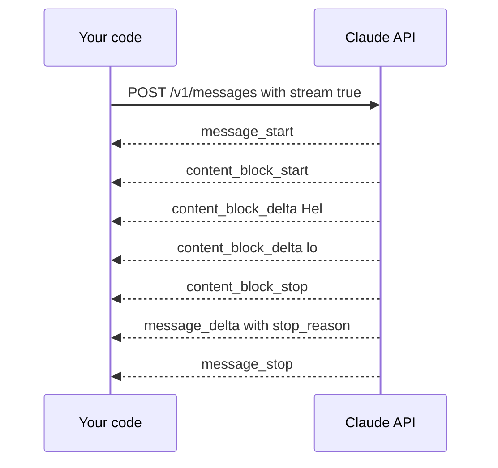

# Lesson 1: Stream Claude token by token

**Goal:** a small program that prints Claude's answer word by word as it arrives.
**Job skill:** LLM API integration and token streaming, named directly in the posting.
**Time:** 1 hour.

## Why streaming

A long answer can take many seconds. If you wait for the whole thing, the app looks frozen.
With streaming the first words appear quickly. Users judge an AI app by this moment.

## What is on the wire

The API answers with Server-Sent Events: lines of text over one long HTTP response.



See it raw before using any SDK:

```bash
curl -N http://127.0.0.1:47101/v1/messages -H 'x-api-key: x' \
  -d '{"model":"claude-opus-5-5","max_tokens":100,"messages":[{"role":"user","content":"hi"}]}'
```

`-N` turns off curl's buffering. Each `data:` line is one small piece.

## Build it: Node

Create `node/src/cli.ts` with one command for now: `stream <text>`.

- `const stream = new Anthropic().messages.stream({ model, max_tokens, messages })`
- `stream.on('text', (delta) => process.stdout.write(delta))`
- `await stream.finalMessage()`

Use `process.stdout.write`, not `console.log`, since `console.log` adds a new line per token.
Read `process.argv` for the command. The rest of the course adds commands to this file.

```bash
source tools/env.sh node
cd node && npx tsx src/cli.ts stream "hello"
```

## Build it: Go

Create `go/cmd/cli/main.go`:

```go
client := anthropic.NewClient() // reads ANTHROPIC_API_KEY and ANTHROPIC_BASE_URL
stream := client.Messages.NewStreaming(ctx, anthropic.MessageNewParams{ /* ... */ })
defer stream.Close()
for stream.Next() {
    event := stream.Current()
    // find the text delta and print it
}
if err := stream.Err(); err != nil { /* handle it */ }
```

Find the delta with a type switch or assertion on `event.AsAny()`. The type you want is
`anthropic.ContentBlockDeltaEvent`, with `Delta.Type == "text_delta"`.

```bash
source tools/env.sh go
cd go && go run ./cmd/cli stream "hello"
```

## Done when

```bash
node tools/check.mjs 1 node
node tools/check.mjs 1 go
```

## Compare

| | Node | Go |
|---|---|---|
| Style | Events and `await` | A loop that pulls the next event |
| Errors | `await` throws | Check `stream.Err()` after the loop |
| Cancel | `AbortSignal` | `context.Context` |

Forgetting `stream.Err()` in Go is a classic bug: the loop ends quietly and the error is lost.

## Interview questions

- Why does streaming feel faster even if the total time is the same?
- How is SSE different from a WebSocket? When would you choose each?
- The stream stops halfway. What do you check first?
