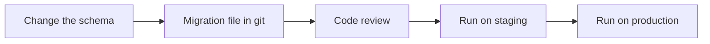
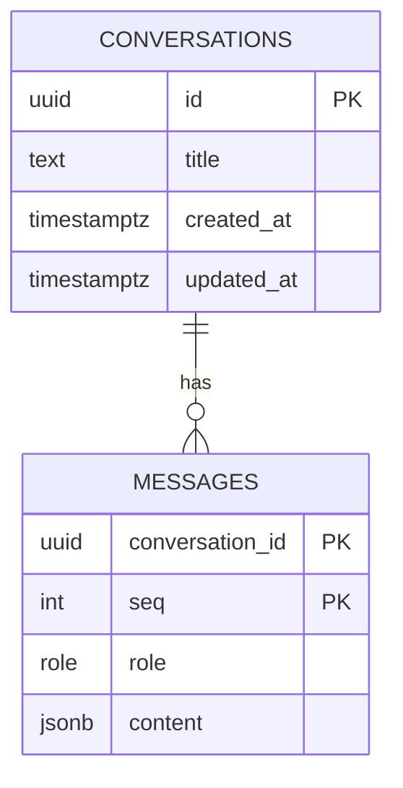

# Lesson 2: Database, ORM and migrations

**Goal:** conversations stored in PostgreSQL through an ORM, with versioned migrations.
**Job skill:** the core of backend work. Almost every backend interview touches this.
**Time:** 2 hours.

## Two ideas

An **ORM** maps tables to objects in your language, so queries are type-checked.

A **migration** is one numbered file that changes the schema, kept in git. Every laptop, test
server and production database runs the same files in the same order. Without them, each database
slowly becomes different, and deployments break.



## The schema



Questions to think about before you type:

- Why is the primary key of `messages` two columns?
- Why `JSONB` for `content`? Claude's content blocks have many shapes, and we must send them back
  unchanged. Normal columns would lose data.
- Why `ON DELETE CASCADE`? So deleting a conversation cannot leave orphan messages.

## Build it: Node with Prisma

Prisma is a very common ORM in Node job posts. You describe the schema, Prisma writes the SQL.

```bash
cd node
npm i @prisma/client@7.10.1 @prisma/adapter-pg@7.10.1
npm i -D prisma@7.10.1
```

Pin the version: when this course was written the `latest` tag of `prisma` was a release candidate.

1. Create `prisma/schema.prisma` and `prisma.config.ts`. Use the Prisma docs, then compare with
   `reference/node`. You need the `prisma-client` generator with `moduleFormat = "cjs"`, because
   this project is CommonJS.
2. Create the migration:

   ```bash
   source ../tools/env.sh node
   npx prisma migrate dev --name init
   ```

   In `prisma.config.ts` use `process.env.DATABASE_URL ?? ''`, not Prisma's `env()` helper. The
   helper throws when the variable is missing, which breaks `npm install` on a clean machine.

3. Open the SQL file it made in `prisma/migrations`, and read it. Always read generated SQL.
4. Write `src/main/db.ts`: a `Store` class with `open`, `create`, `list`, `has`, `messages`,
   `append` and `close`.
5. Add `db-smoke` to `src/cli.ts`. It creates a conversation, appends a user and an assistant
   message, and prints `{ id, listed, messages }` as JSON.

`append` must find the next `seq` and insert in one `$transaction`. Think about why.

## Build it: Go with GORM and goose

GORM is the most used Go ORM. It does not manage versioned migrations well by itself, so we use
goose, which runs plain `.sql` files.

```bash
cd go
go get gorm.io/gorm@v1.31.2 gorm.io/driver/postgres@v1.6.3
go get github.com/pressly/goose/v3@v3.29.0 github.com/jackc/pgx/v5
```

1. Write `migrations/00001_init.sql` by hand, with `-- +goose Up` and `-- +goose Down`. This time
   you write the SQL yourself. `Down` is how you roll back.
2. Add `migrations/embed.go` with `//go:embed *.sql`, so the files ship inside the binary.
3. Write `cmd/migrate/main.go`, which runs `goose.RunContext` with `up`, `down` or `status`.

   ```bash
   source ../tools/env.sh go
   go run ./cmd/migrate up
   go run ./cmd/migrate status
   ```

4. Write `internal/store/store.go` with structs and GORM tags.
5. Add `db-smoke` to `cmd/cli/main.go`, with the same JSON output as Node.

Try the rollback: run `down`, then `up`. In Node, Prisma has no `down`: you write a new migration.

**Do not use `db.AutoMigrate`.** You will see it in many tutorials. It changes the schema when the
app starts, with no review and no rollback. Fine for a demo, risky in production. Knowing this is
a good interview signal.

## Done when

```bash
node tools/check.mjs 2 node
node tools/check.mjs 2 go
```

Look inside the database too:

```bash
docker compose exec postgres psql -U desk -d desk_node -c '\d messages'
```

## Compare

| | Prisma | GORM + goose |
|---|---|---|
| Source of truth | `schema.prisma` | SQL migration files |
| Who writes SQL | Prisma generates it | You write it |
| Type safety | Very strong, generated client | Weaker, strings in `Where` |
| Rollback | Write a new migration | `Down` section |
| Style | `db.message.findMany({...})` | `db.Where(...).Find(&out)` |

Other names you will see in job posts: **Drizzle** and **TypeORM** in Node, **sqlc** and **Ent** in
Go. Ask `/explain` if you want to compare them.

## Interview questions

- What is a migration, and why not just edit the database?
- How do you add a NOT NULL column to a big table that already has data?
- What is an N+1 query? How would you see one with your ORM?
- Why does `append` need a transaction? What happens if two requests run at the same time?
- When would you skip the ORM and write SQL?
