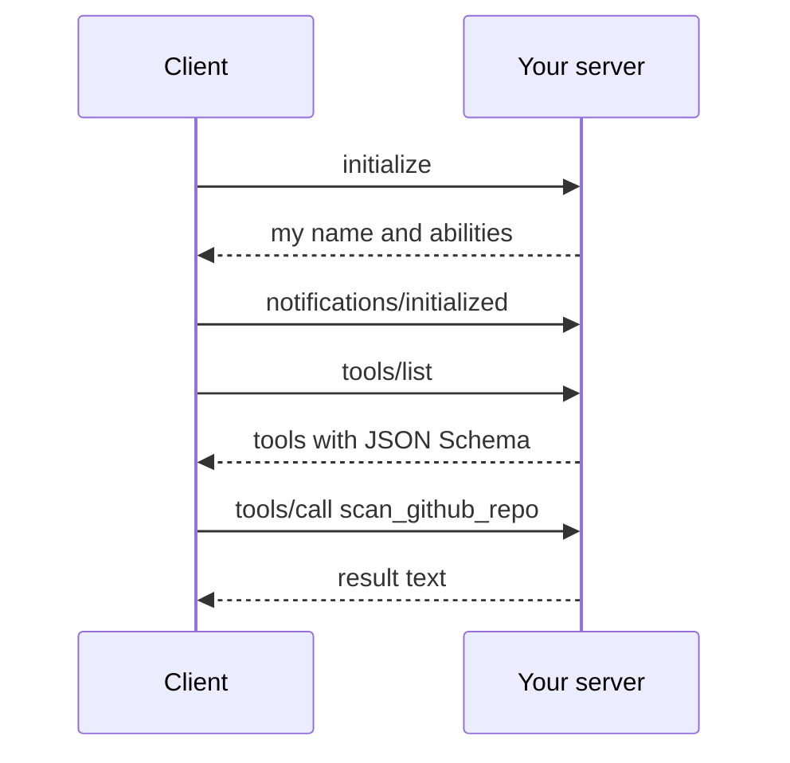

# Lesson 3: Build an MCP server

**Goal:** your own Redproof MCP server, usable from Claude Desktop or Claude Code.
**Job skill:** this is the company's whole field. This lesson makes "I build MCP servers" true.
**Time:** 1.5 hours.

## What MCP is

The Model Context Protocol is a standard way for an AI app to use tools. It works like USB: one
plug shape, so any client can use any server.

Over stdio, the transport is simple. The client starts the server as a child process. They send
one JSON object per line over stdin and stdout.



**The rule that bites everyone:** stdout belongs to the protocol. A stray `console.log` or
`fmt.Println` breaks the connection. Log to stderr.

## The two tools

| Tool | Input | Does |
|---|---|---|
| `scan_github_repo` | `url`, `owner_confirmed` | POST `/scans/github`, returns the token |
| `get_report` | `token` (43 characters) | GET `/scans/{token}`, returns score and findings |

If `owner_confirmed` is false, return an error result and do not start a scan. Scanning code you
do not own is a real risk, so the tool description also tells Claude to ask first.

Tool errors are **results** with `isError: true`, not crashes. That way Claude can read the
problem and try again.

The report text must contain `83/100` from the fake data, and a `Fix prompt:` line per finding.

## Build it: Node

File: `node/servers/redproof-mcp.ts`.

```ts
const server = new McpServer({ name: 'redproof', version: '0.1.0' });
server.registerTool('scan_github_repo', { title, description, inputSchema: { /* zod */ } }, handler);
void server.connect(new StdioServerTransport());
```

Use `fetch` with `AbortSignal.timeout(30_000)`. Read the API address from `REDPROOF_API`.

## Build it: Go

File: `go/cmd/redproof-mcp/main.go`.

```go
server := mcp.NewServer(&mcp.Implementation{Name: "redproof", Version: "0.1.0"}, nil)
mcp.AddTool(server, &mcp.Tool{Name: "scan_github_repo", /* ... */}, scanGitHubRepo)
err := server.Run(context.Background(), &mcp.StdioTransport{})
```

A handler looks like this. `AddTool` is generic, so the SDK decodes the input into your struct:

```go
func scanGitHubRepo(ctx context.Context, _ *mcp.CallToolRequest, in scanInput) (*mcp.CallToolResult, any, error)
```

The SDK can build a schema from your struct, but give `InputSchema` by hand as a map. Then you can
set `format: uri` and the token `pattern`, the same rules as Node.

## Try it by hand

```bash
printf '%s\n' '{"jsonrpc":"2.0","id":1,"method":"initialize","params":{"protocolVersion":"2025-06-18","capabilities":{},"clientInfo":{"name":"me","version":"1"}}}' \
  | (cd node && npx tsx servers/redproof-mcp.ts)
```

You are speaking the protocol with no client at all. Press Ctrl+C to stop.

## Done when

```bash
node tools/check.mjs 3 node
node tools/check.mjs 3 go
```

## Compare

| | Node | Go |
|---|---|---|
| Input validation | zod schema, inferred types | JSON Schema map plus a struct |
| Delivery | Needs Node installed | One binary, easy to share |
| Handler errors | `try` / `catch` | Check `err` on each call |

Go's single binary is a real advantage for tools people install.

## Interview questions

- Why does a tool return an error result instead of throwing?
- Why can a stray print statement break an MCP server?
- How would you write a good tool description? Who reads it?
- Stdio or HTTP transport: when would you use each?
