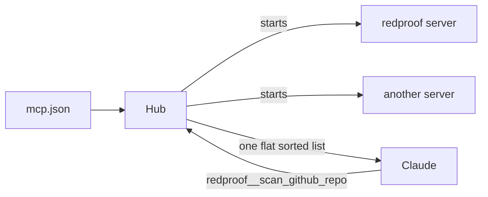

# Lesson 4: Build an MCP client

**Goal:** a hub that connects to many MCP servers and shows them to Claude as one tool list.
**Job skill:** "MCP client implementation, tool calling, transport protocols" from the posting.
**Time:** 1.5 hours.

## What the hub does



Four jobs:

1. **Start each server** from a config file. One broken server must not stop the others.
2. **Prefix names** as `server__tool`, so two servers can both have `search`.
3. **Validate input** against the tool's JSON Schema before calling. Lesson 5 explains why.
4. **Keep secrets away.** Each child gets only `PATH`, `HOME` and its own config. Never pass the
   whole environment, since that would give every server your API key.

The list is sorted because the prompt cache needs identical bytes on each request. Map order in Go
is random and would quietly ruin your cache hits.

## Config

Create `node/mcp.json` and `go/mcp.json`:

```json
{ "servers": [ { "name": "redproof", "command": "npx", "args": ["tsx", "servers/redproof-mcp.ts"],
  "env": { "REDPROOF_API": "http://127.0.0.1:47102/api/v1" } } ] }
```

In Go use `"command": "go", "args": ["run", "./cmd/redproof-mcp"]`.

## Build it: Node

File: `node/src/main/mcp.ts`, class `McpHub` with `readConfig`, `connectAll`, `definitions`,
`call`, `close` and `summary`.

- `new StdioClientTransport({ command, args, cwd, env, stderr: 'ignore' })`
- `new Client({...})`, `client.connect(transport)`, `client.listTools()`, `client.callTool(...)`
- Use `Promise.all` with a `.catch` per server, and save errors in `hub.errors`.
- Validate with Ajv and `ajv-formats`. Without `addFormats`, `format: uri` is ignored.

## Build it: Go

File: `go/internal/hub/hub.go`.

```bash
go get github.com/santhosh-tekuri/jsonschema/v6
```

- `mcp.NewClient(...)`, `client.Connect(ctx, &mcp.CommandTransport{Command: cmd}, nil)`
- `session.ListTools(ctx, nil)`, `session.CallTool(ctx, &mcp.CallToolParams{...})`
- Set `cmd.Env` to a short list. `exec.Command` inherits everything if you leave it empty.
- Start one goroutine per server with a `sync.WaitGroup`, and protect shared maps with a
  `sync.Mutex`.
- Call `compiler.AssertFormat()`. Formats are off by default, the same trap as Ajv.

## Add the command

Add `hub-smoke` to both CLIs. It connects, lists tools, makes one valid call and one call with
`url: "not a url"`, and prints `{ tools, errors, valid, invalid }`. Keep `valid` and `invalid` as
`{ text, isError }`.

## Done when

```bash
node tools/check.mjs 4 node
node tools/check.mjs 4 go
```

## Compare

| | Node | Go |
|---|---|---|
| Doing things at once | `Promise.all` | Goroutines and `WaitGroup` |
| Shared data | Safe, one thread | Needs a `Mutex` |
| Child environment | `env` option | `cmd.Env` |

Run `go run -race ./cmd/cli hub-smoke` to let Go find data races for you.

## Interview questions

- Why prefix tool names? Why sort the list?
- Why do child processes not get the full environment?
- What happens if a server dies in the middle of a call?
- Node is single-threaded. Why does Go need a mutex here when Node does not?
