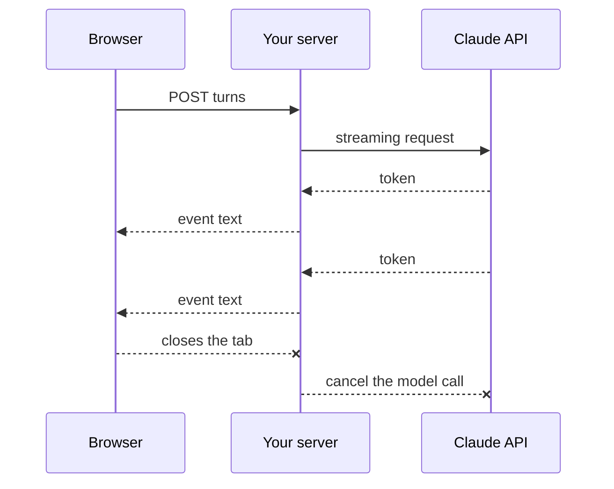

# Lesson 6: REST API and Server-Sent Events

**Goal:** the same agent as a backend, streaming tokens to any client.
**Job skill:** REST design and end-to-end streaming, a named requirement in the posting.
**Time:** 1.5 hours.

## The API

| Method | Path | Answer |
|---|---|---|
| POST | `/api/conversations` | 201, the conversation |
| GET | `/api/conversations` | 200, the list |
| GET | `/api/conversations/{id}/messages` | 200, display items, or 404 |
| POST | `/api/conversations/{id}/turns` | `text/event-stream`, or 400 on empty text |

`toDisplay` turns stored messages into `user`, `assistant` and `tool` items, and hides thinking.
Node: `src/main/display.ts`. Go: `internal/display/display.go`.

## End to end



Each frame looks like this, with a blank line at the end:

```
event: text
data: {"type":"text","delta":"Hello"}

```

## Rules to get right

- **Flush after each event.** Otherwise the server collects them and they arrive in one lump.
- **Stop when the client leaves.** Nobody should pay for tokens nobody reads.
- **Heartbeat.** Send `: ping` every 15 seconds so proxies keep the connection open.
- **`X-Accel-Buffering: no`** stops nginx from buffering.
- **Bind to `127.0.0.1`** unless you mean to be public.
- **No person, no approval.** Only tools in `AUTO_APPROVE_TOOLS` run. Everything else is declined.
- **Limit body size** at 64 KB.

## Build it: Node

File: `node/src/server/http.ts`, with plain `node:http`, so you see what frameworks hide.

- `res.writeHead(200, {...})`, `res.flushHeaders()`, `res.write(...)`
- `req.on('close', () => controller.abort())`

## Build it: Go

File: `go/cmd/server/main.go`. Since Go 1.22 the standard router handles methods and parameters:

```go
mux.HandleFunc("POST /api/conversations/{id}/turns", a.turn)
id := r.PathValue("id")
```

- `http.NewResponseController(w).Flush()` after each write
- `r.Context()` ends when the client leaves. Pass it to the agent, and cancelling is done for you.
- Do not set `WriteTimeout` on the server: a turn can last minutes.

**The Go trap:** the heartbeat and the agent both write to `w`, and that is not safe at once. In
the reference, one goroutine owns the writing, and everything else sends strings into a channel.
"Share memory by communicating" is the Go idea to remember.

## Try it

```bash
curl -N -X POST localhost:8787/api/conversations/<id>/turns \
  -d '{"text":"scan https://github.com/demo/app"}'
```

Run `AUTO_APPROVE_TOOLS=redproof__scan_github_repo` and see the tool run instead of being declined.

## Done when

```bash
node tools/check.mjs 6 node
node tools/check.mjs 6 go
```

## Compare

| | Node | Go |
|---|---|---|
| Router | Your own code, or Express/Fastify | `net/http` is enough |
| Client left | `req.on('close')` | `r.Context().Done()` |
| Many clients | Event loop | One goroutine per request |
| Concurrent writes | Cannot happen | Your job: use a channel |

In Node jobs you will often see **NestJS** or **Fastify**, and in Go **Gin** or **chi**. Knowing
the plain version makes all of them easy.

## Interview questions

- How does a token get from Claude to the browser? Name each step.
- Why POST for a stream? `EventSource` only supports GET, so how would a browser read it?
- The tokens all arrive at once in production but not locally. Why?
- How would you run this on many servers? What about an approval that waits on one of them?
