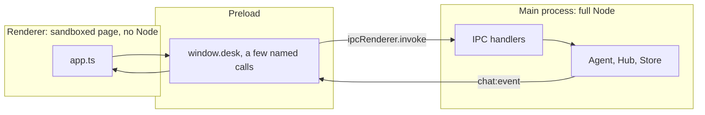

# Lesson 7: The user interface

**Goal:** a real window on top of your agent. Electron in Node, a web page in Go.
**Job skill:** "Electron-based applications with secure IPC communication" from the posting.
**Time:** 2 to 3 hours.

## Why the tracks differ here

Electron is a JavaScript framework, so Go cannot use it. The Go track serves a small web page
instead. A Go team that wants a true desktop app would look at **Wails**, which uses the system
web view with a Go backend. This lesson is the one place the two tracks build different things.

The job needs Electron, so give the Node side the most attention.

## Node: Electron

Electron has two worlds, and the security model is about keeping them apart.



If the page could reach Node, a script injection would become full control of the laptop. Model
output is untrusted, so treat this as a real threat.

### Steps

```bash
cd node && npm i -D electron
```

Copy `reference/node/renderer/` and `reference/node/tsconfig.renderer.json` first, since this
lesson is about the backend half, then read them.

1. `src/main/main.ts`: create the window with `contextIsolation: true`, `sandbox: true` and
   `nodeIntegration: false`.
2. Block navigation with `will-navigate`, and open links in the real browser.
3. `src/main/preload.ts`: `contextBridge.exposeInMainWorld('desk', {...})`. Never expose
   `ipcRenderer` itself.
4. Every handler checks that the sender is your own page, and validates its arguments.
5. `approve` returns a Promise that the Allow or Decline click resolves. This is the part to
   understand fully: a turn in the main process waits on a click in another process.

```bash
source ../tools/env.sh node
npm run build && npx electron .
```

`DATABASE_URL` comes from your shell, so start it from a terminal with the environment set.

## Go: web page

1. `web/index.html` plus `web/embed.go` with `//go:embed index.html`.
2. Add `mux.Handle("GET /", http.FileServerFS(web.FS))`.
3. Use `fetch` and read `res.body` as a stream, then split on the blank line. `EventSource` cannot
   POST, so you parse the frames yourself.
4. Set text with `textContent`, never `innerHTML`. Model output must not run as HTML.

```bash
source ../tools/env.sh go
AUTO_APPROVE_TOOLS=redproof__scan_github_repo go run ./cmd/server
```

Open `http://127.0.0.1:8787`.

**Stretch:** add real approvals over HTTP. The server sends an `approval` event and waits, and the
page answers with a POST. This teaches you how to pass a waiting request between two connections.

## Done when (checked by hand)

**Node**
- [ ] A window opens, and the server shows as connected
- [ ] Tokens appear one by one
- [ ] A tool card fills in as Claude writes the input
- [ ] Allow runs the tool, and Decline tells Claude
- [ ] Old conversations reopen after you restart the app

**Go**
- [ ] The page loads from the binary, with no separate files
- [ ] Tokens appear one by one
- [ ] The tool result shows when the tool is auto-approved

## Interview questions

- What do `contextIsolation`, `sandbox` and `nodeIntegration` each do?
- Why expose named functions instead of `ipcRenderer`?
- Why render model output as text and not HTML?
- How does the approval click get back to the code waiting in the agent?
- Electron or Tauri or Wails: what are the trade-offs?
